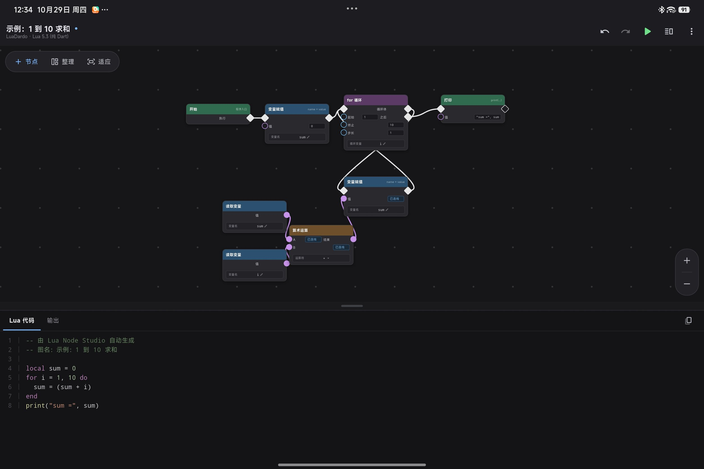

# Lua Node Studio（Lua 节点工作室）

Flutter 可视化节点编程编辑器：在画布上拖拽节点、连线，实时生成 Lua 源码，并用内置 Lua 5.3 运行时直接执行、查看输出。同一份代码支持 **Android** 与 **Windows** 双平台。

当前版本 **v1.3.0 (build 4)**，Android 安装包见 [`installer/`](installer/)。



## 功能

- **可视化节点画布**：节点拖拽、端口连线、网格背景、缩放/平移，适配手机与桌面窗口尺寸
- **内置节点库**：流程 / 数据 / 数学 / 控制 / 函数五类节点（定义见 `lib/models/node_spec.dart`）
- **带参数函数**：`定义函数` 节点支持参数列表（逗号分隔，如 `a, b`），参数会变成节点上可连线的数据端口；`调用函数` 最多传 3 个参数，可用 `返回值` 端口接收结果；`结束` 节点可写 `return 表达式`
- **一键生成 Lua 代码**：执行流决定语句顺序，数据流递归展开为表达式；分支与循环用「汇合点」规则收口，无需额外 merge 节点（`lib/codegen/lua_generator.dart`）
- **内置 Lua 5.3 运行时**：纯 Dart 实现（`lua_dardo_plus`），在 Isolate 中执行并默认 8 秒超时，不阻塞 UI（`lib/engine/lua_engine.dart`）
- **输出面板**：查看运行时 stdout、错误与耗时
- **工程管理**：JSON 工程保存 / 打开，编辑自动保存并在下次启动时恢复（应用文档目录 `LuaNodeStudio/`）
- **内置示例图**：1 到 10 求和、阶乘、斐波那契数列、最大公约数、素数判断，从菜单「载入示例图」一键切换（`lib/samples/`）
- **撤销 / 重做**、节点自动布局
- 深色 Material 3 主题

## 下载与安装

两个平台的产物都发布在 [Releases](https://github.com/ONGIKAN/lua-node-studio/releases)；仓库内也附带了最新 Android 安装包。

### Android

| 项目 | 说明 |
| --- | --- |
| 文件 | `installer/lua_node_studio-v1.3.0-release.apk` |
| 版本 | 1.3.0 (versionCode 4) |
| 包名 | `com.luanode.lua_node_studio` |
| 大小 | 约 51.5 MB |

下载后允许“安装未知应用”即可安装。

### Windows（桌面版）

| 项目 | 说明 |
| --- | --- |
| 文件 | Release 资产 `lua_node_studio-v1.3.0-windows-x64.zip` |
| 版本 | 1.3.0 |
| 系统要求 | Windows 10 / 11 x64 |
| 大小 | 约 12 MB |

解压后双击 `lua_node_studio.exe` 即可运行；`data/` 目录与 dll 需要和 exe 保持在同一个文件夹里。

## 本地开发

环境：Flutter 3.x（Dart SDK ^3.12.2）

```bash
flutter pub get
flutter run                      # 运行到已连接的设备 / 模拟器
flutter test                     # 单元 + Golden 测试
flutter build apk --release      # 构建 Android 安装包
flutter build windows --release  # 构建 Windows 桌面版
```

Android 产物在 `build/app/outputs/flutter-apk/`，Windows 产物在 `build/windows/x64/runner/Release/`（需安装 Visual Studio 的“使用 C++ 的桌面开发”工作负载）。

## 目录结构

```
lib/
  main.dart          应用入口与主题
  ui/                编辑器页面、节点画布、输出面板、编辑对话框
  models/            图数据模型、节点注册表、自动布局
  state/             图编辑控制器（撤销/重做、运行、保存）
  codegen/           节点图 → Lua 源码生成器
  engine/            Lua 运行时（Isolate + 超时控制）
  storage/           工程 JSON 存取
  samples/           内置示例图
android/             Android 平台工程
windows/             Windows 桌面平台工程
test/                单元与 Golden 测试
installer/           Android 安装包（APK）
```

## 技术栈

Flutter / Dart · Material 3 · [lua_dardo_plus](https://pub.dev/packages/lua_dardo_plus)（纯 Dart Lua 5.3） · [path_provider](https://pub.dev/packages/path_provider)

## 更新日志

### v1.3.0

- `定义函数` 节点支持参数列表（如 `a, b`），参数自动变成可连线的数据端口
- `调用函数` 节点支持最多 3 个参数，并可把返回值接到其它节点；`结束` 节点支持 `return 表达式`
- 新增 4 个常见算法示例：阶乘、斐波那契数列、最大公约数、素数判断
- 菜单「载入示例图」改为示例选择对话框；补充示例执行与代码生成的自动化测试
- 新增 **Windows 桌面版**：同一份 Dart 代码编译为 Android APK 与 Windows 可执行程序

### v1.2.0

- 首个公开版本：节点画布、Lua 代码生成、内置 Lua 5.3 运行时、工程保存与自动保存
